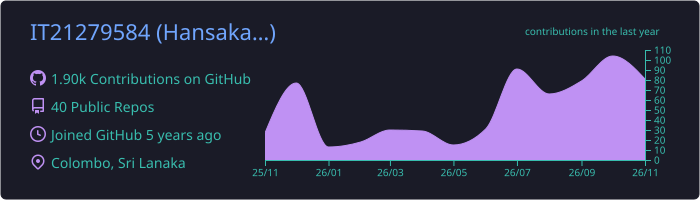

<!-- ===== Hero ===== -->

  

  <h1>Hi 👋, I'm Hansaka Sudusinghe</h1>
  <h3>Full-Stack Software Engineer · Java · Spring Boot · React.js</h3>

  

    

  
  
  
  

   

  
  

---

##  About Me

**Full-Stack Software Engineer** focused on building **web and enterprise applications** with **Java, Spring Boot and React.js**: scalable, secure backends and clean, responsive UIs. I care about writing code that's reliable, well-structured and easy to maintain.

- 💼 **Role:** Full-Stack Software Engineer
- 🎓 **Education:** BSc (Hons) in IT, specialising in Software Engineering
- 🏢 **Focus:** Full-stack web & enterprise applications: Java & Spring Boot (backend) · React.js (frontend)
- 🤝 **Open to:** Collaborating on open-source projects
- 📫 **Contact:** [hansakajayawarna@gmail.com](mailto:hansakajayawarna@gmail.com)
- 🎮 **Off the clock:** Movies & games

---

## 🛠 Languages & Tools

  

---

## 🔥 My Stats

  
  

  

<!-- Contribution graph (generated by .github/workflows/profile-summary.yml) -->

  

---

## 🐍 Contribution Snake

<!-- Needs the snake.yml GitHub Action (see .github/workflows/snake.yml) -->

  <picture>
    <source media="(prefers-color-scheme: dark)" srcset="https://raw.githubusercontent.com/IT21279584/IT21279584/output/github-snake-dark.svg" />
    <source media="(prefers-color-scheme: light)" srcset="https://raw.githubusercontent.com/IT21279584/IT21279584/output/github-snake.svg" />
    
  </picture>

---

  

